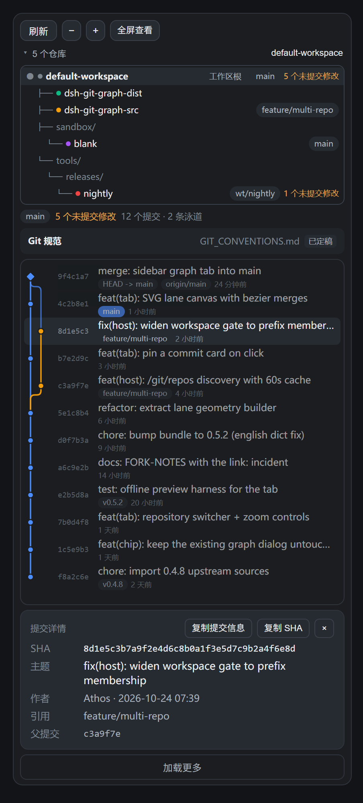

# dsh-git-graph-sidebar

English | [中文](README.zh.md)

A Git browsing plugin for DeepSeek Harness (DSH): a branch chip in the composer, plus a **Repository graph** tab inside [dsh-better-sidebar](https://www.npmjs.com/package/dsh-better-sidebar) that lists the Git repositories found up to three levels below the current workspace directory and draws the selected repository's commit graph as an SVG lane canvas.



## What it does

### Repository graph tab (better-sidebar)

The tab works from the session's working directory and treats that directory as a container: Git repositories up to three levels below it are reachable without registering each repository as a separate DSH workspace.

- **Multi-repository discovery** — the workspace root itself, plus repositories nested up to 3 levels below it. Each entry carries its current branch, short head, dirty-file count and conflict count.
- **Repository tree** — the root, the intermediate directories and each repository, so the level relationship between them is visible rather than implied by a path.
- **SVG commit graph** — one row per commit, one colored lane per branch line, curved edges where a commit's parent sits on another lane, merge commits drawn as diamonds, ref badges and relative timestamps.
- **Zoom** — rows are two lines by default; `−` / `+` scale the rows and their text from a compact single line up to a roomy list.
- **Commit detail card** — the panel under the graph always shows the row you pinned: full hash, subject, author, absolute commit time, refs and parents. Click a row to pin it, click it again (or `×`) to clear.
- **Copy for the assistant** — *Copy commit info* puts a ready-to-paste block on the clipboard (repository path, hash, subject, author, time, refs, parents), so asking the model to "roll back to this commit" needs no retyping; *Copy SHA* copies the full hash alone.
- **Export an image** — *Export image* on the toolbar serialises the current view (filtered rows, lanes, ref chips, the highlight on the pinned row) into one standalone SVG: theme colours baked in, explicit size, downloaded as `git-graph-<repo>.svg`; environments without Blob/object URLs fall back to copying the markup.
- **Live updates, no flicker** — the tab subscribes to the host's Git change events and also polls quietly in the background, so a new commit or branch appears on its own. Every background refresh keeps the current rows on screen: an unchanged result is dropped without a re-render, and a failed poll never replaces real data with an error.
- **Refresh** — re-scans on demand. A manual refresh also keeps the panel content visible while it runs. The host caches a scan for 60 s (the refresh button bypasses it).
- **Reopens instantly** — closing and reopening the tab used to start from an empty panel. The tab now keeps the last painted list, selection and graph in memory, so a reopen draws that on its first frame and refreshes behind it.
- **Selected repository is obvious** — the active row in the repository tree is highlighted with a cyan tint and ring, so the repository whose graph is on screen is never ambiguous.
- **Git conventions** — a strip above the graph states which convention document the selected repository carries (`draft` / `settled` / missing), opens it in the editor, and offers six proven frameworks to bootstrap a brand-new repository.
- **One-click repository init** — a workspace directory that is not a repository yet gets an *Initialize Git repository* button. It asks once (target path and initial branch: `main` / `master` / `trunk` / `develop`), runs `git init -b <branch>` there, and then the conventions scaffold and framework picker open by themselves. It refuses when the directory already sits inside a repository, so it can never re-root an existing checkout.

- **Commit compliance** — below the conventions strip the last 20 commits are checked against the rules the document itself states (subject length cap, the type vocabulary, lowercase start, no trailing period, imperative mood); it reports *2 of the last 5 commits do not match* and lists the first few offenders with their reasons. A document with no checkable rule says so instead of guessing.
- **Upgrade preview** — on a repository that already carries a document, *Switch framework* no longer overwrites it: the tab first shows *What would change* — how many sections are added, rewritten or removed, with the titles — and nothing is written until *Write it* is pressed. *Cancel* leaves the file untouched.
- **Workspace document** — once the workspace holds more than one repository a *Workspace conventions* strip appears under the toolbar and writes `<workspace>/.dsh/GIT_CONVENTIONS.md` in one click; a repository without its own document inherits it and the injected block names the directory it came from.
- **Strict mode** — the picker used for a new document, a framework switch and the workspace document carries a *Strict* switch: it writes `strict: true`, and the injected block then tells the agent to rewrite an offending message before committing; the conventions strip shows a *Strict* badge. The list collapses as soon as a card is picked.
- **Chinese, English and mixed subjects** — compliance accepts all three: `新增` / `修复` / `文档` work as type aliases (so does a full-width colon), and the lowercase and imperative checks only run when the first word is Latin, so Chinese subjects are never flagged for case.

### Branch chip (composer)

The chip that ships with the upstream plugin is unchanged: on a blank conversation it lets you switch or create a branch, and it opens the interactive commit-graph dialog and the worktree manager. Branch operations run in the host process; the chip hides itself on active sessions.

## Requirements

| Item | Value |
| --- | --- |
| DSH | `>=0.2.1-rc.2 <0.3.0-0` |
| Node (host runtime) | `^22.19.0 \|\| >=24.0.0` |
| `dsh-better-sidebar` | needed **for the tab only** — without it the plugin still loads and the chip keeps working |

## Install

Grab the prebuilt bundle from the [latest release](https://github.com/Athosoo/dsh-git-graph-sidebar/releases/latest) — `dsh-git-graph-sidebar.tgz`, no build step needed — then install it as a plugin bundle:

- **Desktop app (the `desktop` profile is owned by the Electron app, so the CLI refuses it):** install the `.tgz` from the app's plugin page.
- **CLI-managed profile:**

  ```sh
  dsh plugin --profile <profile> add github:Athosoo/dsh-git-graph-sidebar
  # or from the downloaded tarball
  dsh plugin --profile <profile> add ./dsh-git-graph-sidebar.tgz
  ```

**Restart DSH after installing.** The host half registers its `/git/*` HTTP routes at startup, so a page refresh alone is not enough for a first install, and an upgraded build is not picked up until the process restarts.

The tab needs [`dsh-better-sidebar`](https://github.com/omdsh-dev/DSH-better-sidebar) installed; without it everything else — the branch chip, the graph dialog, worktrees — keeps working and only the sidebar tab is absent.

## Repository discovery rules

| Rule | Value |
| --- | --- |
| Scan depth | 3 levels below the working directory (a repository found at a level is not descended into) |
| Upper bound | 200 repositories per scan, then the result is flagged as truncated |
| Skipped directory names | `node_modules`, `dist`, `build`, `out`, `coverage`, `target`, `vendor` — plus every dot-directory |
| Repository marker | a `.git` entry (directory, file or symlink — so worktrees and submodules are both detected) |
| Per-entry status budget | 5 s; an entry whose `git status` did not return in time is still listed, without branch metadata |
| Cache | 60 s per base path, shared between concurrent requests; the tab's refresh button bypasses it |

## Git conventions

A commit graph shows what happened; a conventions document records what the team agreed to do next time. The tab can bootstrap that document for every repository it lists.

- **Bring your own document** — the plugin never invents house rules. It writes an empty scaffold with six sections marked `待定` / *to decide* and `status: draft`, so the team fills in the decisions instead of inheriting someone else's defaults.

- **Triggered by a new repository** — a repository that has no document and no commits yet (`unborn HEAD`) gets the empty scaffold automatically, and the framework picker opens right away. Repositories that already contain commits but no document are listed as missing it; one click writes the scaffold.

- **Six proven frameworks** — picking one writes its full template into the document and flips it to `status: settled`:

  | Framework | Best for |
  | --- | --- |
  | Conventional Commits | changelogs and semantic versions generated from commit messages |
  | GitHub Flow | small teams shipping from `main` with short-lived feature branches |
  | Git Flow | versioned releases promoted across several environments |
  | Trunk-based development | continuous delivery with very short-lived branches |
  | Conventional Branch | branch names that encode type and issue reference |
  | GitLab Flow | explicit environment branches between `main` and production |

- **Never overwrites** — an existing document is only replaced when the request carries `force`, which the UI does not offer for settled documents. The document is plain Markdown in the repository root, so it is reviewed and revised like any other source file.
- **The assistant actually reads it** — the host registers a `systemPrompt` section that is assembled before *every* model step, so the running agent is always told where the document is for the session's repository and gets its rules (up to 3 000 characters) inline. Nothing is injected for a workspace where no repository documents anything, and the text is cached per file mtime, so a step never re-reads an unchanged file.
- **The nearest document wins** — the section resolves the document in three steps: the repository the session directory is in, then the nearest enclosing repository (a monorepo container), then an index of the documented repositories below it. An inherited document is labelled `inherited Git conventions` and names the repository it came from, so an agent inside `packages/api` follows the container's rules until `packages/api` writes its own. The index walks up to three levels down, skipping dot directories and `node_modules`.

## Initializing a repository

A workspace does not have to start as a repository. When the root of the workspace is not one, the tab's toolbar offers **Initialize Git repository** (and a workspace with no repositories at all shows the same button in the empty panel).

- **Two steps, never one click** — the button opens a bar that names the target directory and the initial branch before anything is written.
- **Only `.git` is written** — `git init` creates the metadata directory; no file in the workspace is touched, and existing repositories below the workspace are unaffected.
- **It refuses to nest** — if the directory already sits inside a repository (including a parent outside the workspace), the host answers `already-repository` instead of creating a second root inside it.
- **It hands over to the conventions flow** — because the new repository has no commits yet, the empty conventions document is scaffolded and the framework picker opens immediately, so the first commit already follows an agreed rule set.

## HTTP routes

Registered by the host half under `/git`; all of them answer JSON (`{ok:true,value}` / `{ok:false,error}`), except `/git/events`, which is a server-sent event stream.

| Route | Purpose |
| --- | --- |
| `/git/repos` | multi-repository discovery for a path (`{path, refresh?}`) |
| `/git/status` | branch, head, dirty/untracked/conflict counts |
| `/git/branches` | branch list with the current one marked |
| `/git/graph` | commit list with parents and refs (`{path, limit?}`) |
| `/git/switch` | switch branch |
| `/git/create-branch` | create and switch |
| `/git/worktrees` | worktree list |
| `/git/worktree-add` | create a worktree |
| `/git/worktree-remove` | remove a worktree |
| `/git/conventions` | convention document state for a repository plus the framework catalog (`{path}`) |
| `/git/convention` | write the document (`{path, framework?, force?}`) |
| `/git/init` | initialize a repository in a directory that has none (`{path, branch?}`) |
| `/git/cleanup` | branch cleanup hints: merged/unmerged counts per local branch (`{path}`) |
| `/git/health` | repository health: detached HEAD, branches without upstream, stash, large untracked files, `.git` size (`{path}`) |
Note: since 1.6.1 `/git/cleanup` and `/git/health` stay as read-only HTTP routes only; the tab no longer has an entry point, and the toolbar dropped *Overview* and *Full-window view*.
| `/git/compliance` | commit compliance: offenders and reasons against the document's own rules, last 20 commits (`{path}`) |
| `/git/convention/preview` | upgrade preview: added/rewritten/removed section counts and titles, read-only (`{path}`, `framework`) |
| `/git/workspace-convention` | workspace document: `state`, `preview` or `write` `.dsh/GIT_CONVENTIONS.md` (`{path}`, `action`, `framework`, `force`) |
| `/git/events` | change notifications (polled by the UI) |

Every route resolves the requested path with `realpath` and rejects it unless it lands inside a registered workspace. Nested repository directories are accepted; anything outside a workspace gets `workspace-unknown`.

## Known limitations

- **The tab never changes an existing repository's Git state.** It writes the conventions document, and it can run `git init` for a directory that is not a repository yet — nothing else. No commits, no branch switching, no worktrees: those stay in the chip's dialog.
- **Do not install this alongside `@linxin666/dsh-client-ui-git-graph`.** Both halves own the `/git` route prefix, and two registrations of the same prefix conflict. Install one or the other.
- **Repositories deeper than 3 levels are not listed**, and a repository inside a skipped directory name (`node_modules`, `dist`, …) is not listed either, by design.
- **The host half is a build output.** `lib/index.js` is edited directly (the added parts sit in marked `//#region` blocks); `lib/client.js` is generated by splicing `src/client/graph/SidebarTab.js` into it. See [DEVELOPMENT.md](DEVELOPMENT.md).

## Development

```sh
npm run build     # splice src/client/graph/SidebarTab.js into lib/client.js
npm run check     # node --check on both bundles
npm run validate  # every t("…") key exists in both locale dictionaries
npm run preview   # render the tab to preview/*.html without a running DSH
```

`npm run preview` writes standalone HTML files (dark and light theme) that show the tab with sample repositories and commits, so layout changes can be checked in a browser without installing anything.

## Attribution and license

Apache-2.0 — see [LICENSE](LICENSE) and [NOTICE](NOTICE).

This is a fork of [`@linxin666/dsh-client-ui-git-graph`](https://www.npmjs.com/package/@linxin666/dsh-client-ui-git-graph) 0.4.8 by linxin666, also Apache-2.0. The branch chip, the commit-graph dialog, the worktree manager and the host git service come from that project. Changes in this fork: renamed package, workspace gate widened from exact-path match to inside-a-workspace, added the `/git/repos` discovery route, added the better-sidebar tab (repository tree, SVG canvas, zoom, pinned commit card) and its locale keys.
